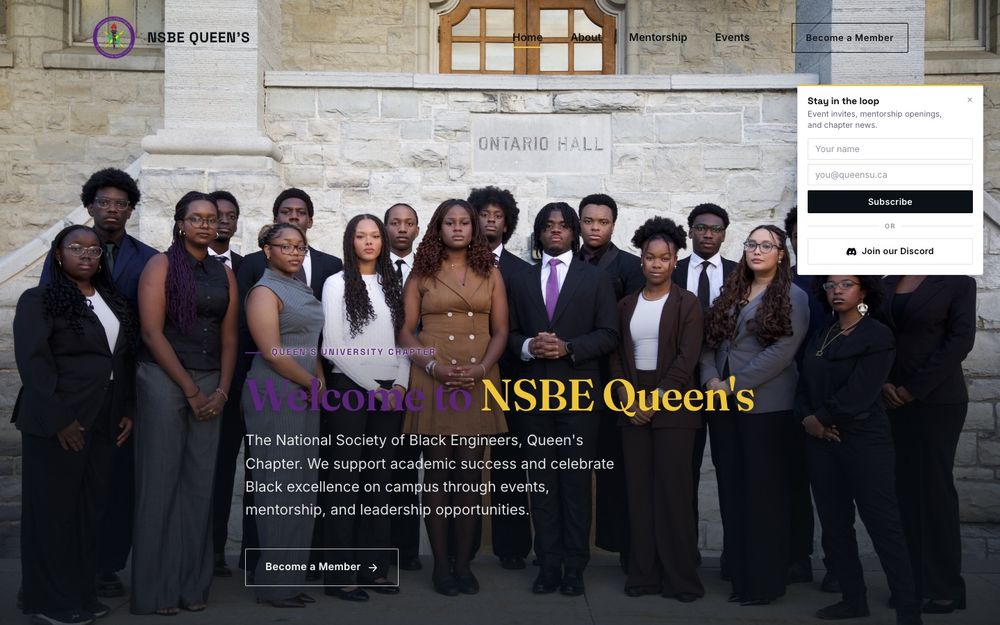

# NSBE Queen's Chapter Website

The official website for the National Society of Black Engineers (NSBE), Queen's University Chapter.

**Live:** https://queens-nsbe.vercel.app



## What it does

- **Home.** Introduces the chapter, with a newsletter signup popup and a Discord invite.
- **About.** The mission, the co-presidents and the 2026–27 executive team.
- **Mentorship.** The chapter's mentorship program and how to take part.
- **Events.** Upcoming and past events, sorted into categories.
- **Join / Contact.** How to become a member and how to reach the exec team.
- **Content editing.** Exec members can update the team, events and page text through TinaCMS, with no code changes.

## Tech stack

| Layer | Tech |
| --- | --- |
| Framework | Astro 7 (static pages + server routes), TypeScript (strict) |
| UI | Astro components, with React islands for interactive parts |
| Backend | Astro Actions on Vercel serverless functions, Zod validation |
| Database | PostgreSQL (Neon in production) via `node-postgres` |
| Content | TinaCMS (content files in `src/content`) |
| Styling | Custom CSS |
| Hosting | Vercel, with Vercel Analytics |

## Newsletter backend

The email list is stored in our own Postgres database, then synced to [Loops](https://loops.so), which sends the emails.

```
SignupForm.tsx (React, in the browser)
   │  actions.subscribe(formData)   → POST /_actions/subscribe
   ▼
src/actions/index.ts (server)       → Zod validates name + email, checks the spam honeypot
   ▼
src/lib/db.ts                       → rate limit per hashed IP, then INSERT … ON CONFLICT
   ▼
Postgres  subscribers table         (schema in db/schema.sql; the source of truth)
   ▼
src/lib/loops.ts                    → create/update the contact in Loops (4s timeout, never blocks a signup)
```

- **Duplicates** are handled by a case-insensitive unique index, so each email is stored once. Returning visitors see "you're already on the list."
- **Spam protection** uses a hidden honeypot field plus a limit of 5 signups per IP per hour. IPs are stored as salted hashes, never in raw form.
- **Unsubscribe**: every subscriber gets a private link, `/unsubscribe?token=…`, which also unsubscribes them in Loops.
- **Export**: `/admin/subscribers.csv` downloads the active list. The browser asks for a password, which is `ADMIN_PASSWORD`.

## Run it

You need Node.js 18 or newer.

```bash
npm install
cp .env.example .env   # then fill in DATABASE_URL, ADMIN_PASSWORD, IP_HASH_SALT (LOOPS_API_KEY optional)
npm run dev
```

For a local database (macOS, Homebrew): `brew install postgresql@17 && brew services start postgresql@17 && createdb nsbe`, then set `DATABASE_URL=postgres://<your-mac-username>@127.0.0.1:5432/nsbe`. The table is created automatically on the first signup.

This starts Astro together with the TinaCMS editor. Open the URL it prints (usually http://localhost:4321). To edit content in the CMS, go to `/admin`.

To build for production:

```bash
npm run build
npm run preview
```
